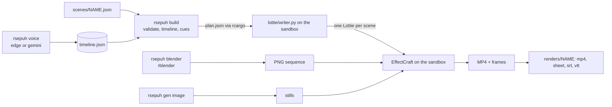
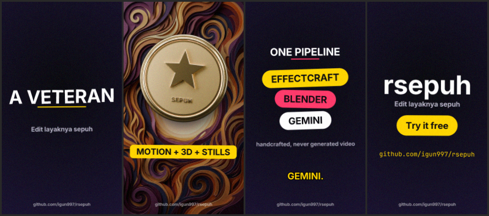
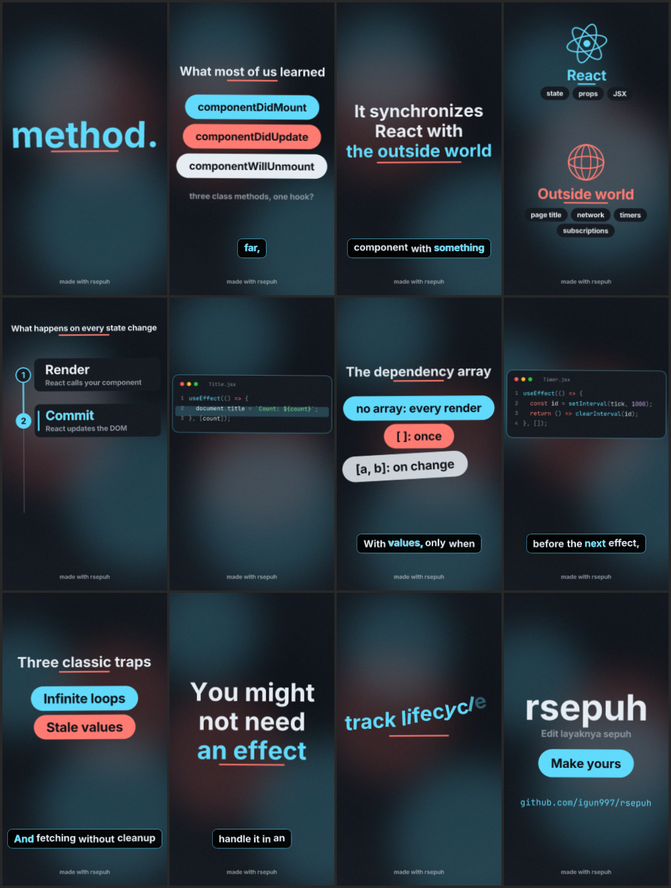
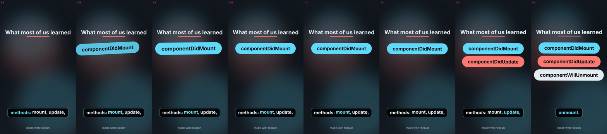
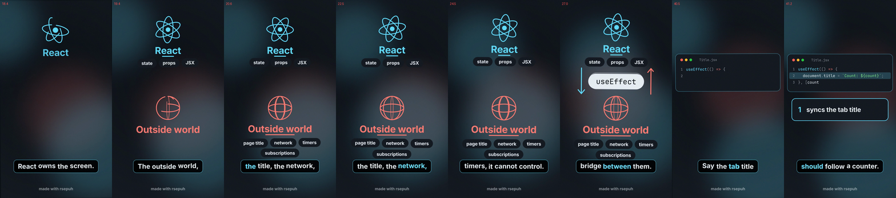
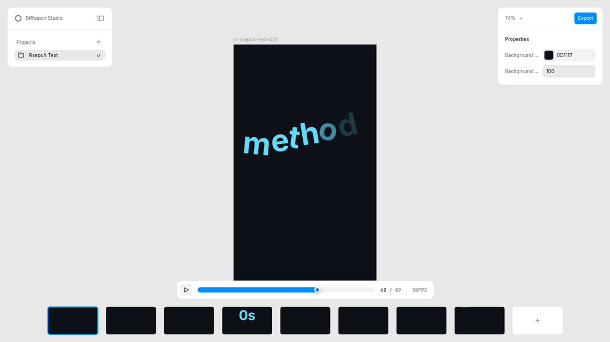

# rsepuh

[](https://github.com/igun997/rsepuh/actions/workflows/ci.yml)
[](https://github.com/igun997/rsepuh/releases)

**Edit layaknya sepuh.** *(Edit like a veteran.)*

UGC-style motion videos (kinetic text, illustrations, stickers, code windows, voice-over, subtitles, 3D seals, end cards) whose motion is written as **Lottie** and composed in [EffectCraft](https://github.com/storytold/effectcraft), with optional [Blender](https://www.blender.org) 3D, rendered on a remote sandbox ([Daytona](https://daytona.io), [instabox](https://instabox.sh), or any Linux server you can SSH into). Your computer stays idle: rsepuh sits on top of [rcargo](https://github.com/igun997/rcargo) and [rblender](https://github.com/igun997/rblender), installs what it needs on the sandbox on first use, and brings back the MP4, a contact sheet and subtitle files.

- **Handcrafted motion, written as Lottie.** A Python motion writer (in your project, `lottie/`) turns every scene into a Lottie file: text drawn as vector glyphs so every letter moves on its own (springs, drops, flips, typing), illustrations that draw themselves on, cards and code windows with eased, overlapping motion. It runs on the sandbox; EffectCraft imports the Lottie and composes it with backgrounds, camera moves, subtitles and sound. Author your own scenes in Python, or bring a Lottie made with the [text-to-lottie](https://github.com/diffusionstudio/lottie) workflow. There is **no video generation** in rsepuh and there never will be (no Veo, no video model of any kind). Gemini is optional and only makes still images and, if you choose, the voice.
- **One spec, one timeline.** A scene is a few lines of JSON. Voice clips are measured, scene lengths follow the voice, and subtitle cues come from the same word times, so picture, sound and words cannot drift.
- **Your look, your call.** Four built-in motion styles, eight subtitle styles, and a `custom` scene type for anything else. Add `styles/yours.json` with just the keys you change.
- **Provable.** `rsepuh verify` parses the MP4 and decodes PNG frames; `rsepuh check` tests the file against TikTok, Reels and Shorts limits. No ffmpeg needed.
- **Made for AI agents.** Ships six agent skills (the tool, Lottie motion, editing craft, subtitles, voice-over, publishing) and an MCP server.

## Easiest: paste this into your AI agent

Open an empty folder in Claude Code, Codex, Cursor or any agent that can run shell commands and paste the prompt. It installs the tools, walks you through logins, and proves everything by rendering a 10 second PV.

````text
Set up rsepuh in this folder so that videos are built and rendered on a remote machine instead of this computer. rsepuh is https://github.com/igun997/rsepuh (read its README if you need details). It sits on rcargo (https://github.com/igun997/rcargo, provides the remote machine) and optionally rblender (https://github.com/igun997/rblender, for 3D).

Work through these steps in order. Whenever a step needs me (a browser login, an API key, choosing a provider, installing software), stop, tell me in plain words exactly what to do and which command or link to use, and wait for me to say it is done. Never invent or guess credentials, and never ask me to paste secrets into this chat.

1. Check `rcargo --version`; if missing install it:
   curl -fsSL https://raw.githubusercontent.com/igun997/rcargo/main/install.sh | sh
   Then `rsepuh --version`; if missing:
   curl -fsSL https://raw.githubusercontent.com/igun997/rsepuh/main/install.sh | sh
   For 3D scenes also `rblender --version`; if missing:
   curl -fsSL https://raw.githubusercontent.com/igun997/rblender/main/install.sh | sh
   Make sure ~/.local/bin is on PATH for this session.
2. Run `rsepuh init` in this folder. It creates a Cargo.toml stub, scenes/, the six rsepuh agent skills, the MCP registration, the Blender scripts and the Lottie motion writer (lottie/), then runs `rcargo init`.
3. Run `rcargo onboard --live`. If it prints SETUP REQUIRED, follow its steps: do the ones not marked [USER] yourself and ask me for the [USER] ones. If no remote machine exists, ask me which I want and recommend instabox (full internet, Blender installs):
   - instabox: `npx instabox@latest`, then `rcargo instances add main --backend instabox --default`
   - Daytona (fine for 2D videos; some Daytona sandboxes block outbound hosts such as download.blender.org, so Blender may not install): I run `daytona login` (or set DAYTONA_API_KEY), then `rcargo instances add dt --backend daytona --set cpu=4 --set memory=8 --set disk=10 --default --description "Daytona sandbox, 4 vCPU"`
   - my own server: `rcargo instances add vps --backend ssh --set host=USER@SERVER --default` (key-based ssh must work; Debian/Ubuntu x86_64)
4. Run `rsepuh doctor`. The first command that needs EffectCraft installs it on the remote (under a minute).
5. Prove it works: `rsepuh render hello --draft`, then `rsepuh verify renders/hello`. Open renders/hello/hello.sheet.png (look at it) and describe what you see.
6. If I want a Gemini key for stills or voice, tell me to put GEMINI_API_KEY in a .env file in this folder (it is git-ignored and never uploaded). Everything else works without it.
7. From now on never install or run EffectCraft, Blender or the motion writer on this computer; they run on the sandbox. Read .claude/skills/rsepuh/SKILL.md (or .agents/skills/rsepuh/SKILL.md) and follow it. Tell me what you set up, which instance is the default, that I may need to restart this agent so it loads the new skills and MCP server, and that `rsepuh down` pauses the sandbox to save money.
````

## Quick start

```sh
curl -fsSL https://raw.githubusercontent.com/igun997/rcargo/main/install.sh | sh
curl -fsSL https://raw.githubusercontent.com/igun997/rsepuh/main/install.sh | sh
# for 3D scenes (optional):
curl -fsSL https://raw.githubusercontent.com/igun997/rblender/main/install.sh | sh

mkdir my-video && cd my-video
rsepuh init                         # project files, skills, MCP, Blender scripts
rcargo instances add main --backend instabox --default   # or Daytona / your own SSH host
rsepuh render hello --draft         # build, render on the sandbox, pull MP4 + contact sheet
rsepuh pv                           # the full 10 second PV: Blender seal, Gemini still, voice, subtitles
```

## Commands

```
rsepuh [-i INSTANCE] <command> [args]

  init [--style S]         make this folder a project (Cargo stub, scenes/, skills, MCP, Blender scripts)
  doctor [--blender]       check rcargo, the sandbox, EffectCraft, voice engines and keys
  setup [--blender]        install EffectCraft (and Blender) on the sandbox now
  styles                   list motion styles, scene types, subtitle styles, voice engines
  new NAME [--style S] [--aspect 9:16] [--text "HOOK WORDS"]   starter spec
  voice SPEC               speak every scene's `voice` line and time the words
  voices [--engine edge|gemini] [--lang id]
  music SPEC [--style house|lofi]           handcrafted music bed + sound effects on the beat grid
  render SPEC [--draft] [--bitrate KBPS]    build + render on the sandbox, pull results
  frame SPEC --at SECONDS  one preview frame
  subs SPEC [--format srt|vtt|both]         SRT/VTT for platforms that want a caption file (exports/NAME/)
  blender SCRIPT [--out NAME] [ARGS]        Blender script -> PNG sequence in assets/3d/NAME
  gen image PROMPT [--out PATH] [--aspect 9:16] [--ref FILE]   Gemini still (never video)
  ec -- ARGS               raw effectcraft-cli on the sandbox
  verify PATH              parse the MP4, decode PNGs
  check FILE [--platform tiktok|reels|shorts|all]
  pv [--engine edge|gemini]                 the 10 second rsepuh PV
  skills [--global]        (re)install the agent skills
  mcp                      MCP server (stdio)
  down                     pause the sandbox
```

Choose a machine with `-i NAME` or `RCARGO_INSTANCE`. `rsepuh render` writes `renders/NAME/`: `NAME.mp4`, `NAME.sheet.png` (one frame per scene), `NAME.ecproj` (the EffectCraft project, open it in EffectCraft to keep editing by hand).

## The spec

`scenes/NAME.json`:

```json
{
  "name": "launch", "aspect": "9:16", "fps": 30, "style": "punch",
  "voice":     { "engine": "edge", "lang": "en-US" },
  "subtitles": { "style": "karaoke" },
  "music":     { "file": "assets/music/bed.mp3", "gainDb": -14, "duckDb": -9 },
  "scenes": [
    { "type": "hook", "dur": 2.0, "words": ["STOP", "SCROLLING"], "voice": "Stop scrolling.", "subtitle": false },
    { "type": "chips", "dur": 2.6, "title": "Why", "items": ["Fast", "Honest", "Yours"], "voice": "Fast. Honest. Yours." },
    { "type": "cta", "dur": 2.4, "title": "launch", "caps": false, "button": "Try it", "url": "example.com" }
  ]
}
```

| Scene | Fields |
|---|---|
| `hook` | `words` or `text`, `sub`, `beat`, `colors`: fast one-word-at-a-time opener |
| `title` | `lines` or `text`, `sub` |
| `media` | `src` (image, video or sequence), `overlay` (alpha PNG sequence, e.g. a Blender render), `caption`, `dim`, `zoom` |
| `chips` | `items`, `title`, `sub`: stickers that pop in with stagger |
| `terminal` | `lines` (lines starting with `$` are typed), `cps` |
| `stat` | `value`, `from`, `prefix`, `suffix`, `label`: counting number |
| `caption` | `text`, `src`, `times`, `y`, `size`: karaoke words as a scene |
| `cta` | `title`, `lines`, `button`, `url`: end card |
| `code` | `code[]`, `file_name`, `focus[]`: code window typed token by token, a bar that glides between lines, callout cards |
| `lottie` | `file`: a Lottie you authored elsewhere, `fit` |
| `custom` | `file`: your own `lottie/scenes/NAME.py` (`build(doc, sc, ctx)`) or a Lottie `.json` |

Every scene also takes `at`, `transition` (`cut`, `flash`, `accent`, `wipe`, `dip`), `caps`, `voice` (+ `voiceStyle`, `voiceLang`), `say`, `subtitle`. `dur` is a minimum when `voice` is present. Sizes are written for a 1080 px short side and scale with the frame (`9:16`, `16:9`, `1:1`, `4:5`, `3:4`, or `"size": [w, h]`). Assets must live inside the project because the sandbox only sees synced files; `.env` and `renders/` are never uploaded.

### Motion styles

| Style | Look |
|---|---|
| `punch` (default) | black and yellow, hard pop-ins, screen shake, flash cuts |
| `smooth` | warm paper, ink text, soft slide-ups |
| `neon` | violet night, cyan and magenta, tilted chips |
| `clean` | white, one blue accent, quick pops, no shake |

A style is a JSON theme (colours, font, pop strength, shake, transition, camera, `aurora` light). Your own `styles/NAME.json` inherits `punch` and overrides only the keys it names; `"theme": {...}` inside a spec overrides per video. The theme colours the Lottie scenes too.

## Motion as Lottie

```
spec + style -> plan.json -> python3 lottie/writer.py -> one Lottie per scene -> EffectCraft imports them
                                                       -> + backgrounds, footage, camera push, transitions, subtitles, audio -> MP4
```

`lottie/` is copied into every project (and never overwritten once there): `kit.py` (shapes, easing, vector text), `rs.py` (helpers), `writer.py`, `scenes/*.py` (the built-in scene types), `fonts/` (Inter Bold and JetBrains Mono outlines, both OFL). To change how a built-in looks, edit its file. To add a scene type write `lottie/scenes/mine.py`:

```python
from rs import *
def build(doc, sc, ctx):
    doc.add(text("Edit like a [[veteran]]", size=ctx.px(150), x=ctx.W/2, y=ctx.cy, color=ctx.th("fg"),
                 accent=ctx.th("accent"), preset="drop", stagger=0.03, max_width=ctx.W*0.86))
```

and use it with `{ "type": "custom", "file": "lottie/scenes/mine.py", "dur": 3 }`. A scene is verified in the official Skottie player with `python3 lottie/writer.py plan.json out --player PLAYER/public` (see `skills/rsepuh-lottie`), then composed. Examples with illustrated diagrams and a timeline are in `examples/useeffect/`.

## Cut on the beat

Add `"bpm": 120` and the spec becomes a beat grid: scene lengths snap up to whole beats (`"snap": "bar"` for bars), hook words, chips, buttons and captions land on beats, and the voice starts on each scene's downbeat. `"music": { "gen": "house" }` (or `"lofi"`) then `rsepuh music SPEC` writes a handcrafted bed (kick, claps, hats, offbeat bass, chord stabs, arpeggio, sidechain pump, a crash on the last downbeat) and `NAME-sfx.wav` (an impact on every cut, a whoosh building into it, ticks and pops on hits). The bed starts at t = 0 with beat 1 on the kick, so cuts and kicks coincide by construction. Transitions: `cut`, `flash`, `accent`, `wipe`, `dip`; each non-cut transition gets its whoosh and impact. Order: `voice` (it fixes scene lengths), `music`, `render`.

## Subtitles

Cues come from voice lines (real word times with the free engine), from `say` on a scene, or from an SRT/VTT `file`. Eight burned-in styles, one line to switch:

| Style | Look |
|---|---|
| `karaoke` | phrase on screen, the spoken word pops in the accent colour |
| `pop` | one huge word at a time |
| `box` | dark rounded box, spoken word highlighted |
| `outline` | white with a black outline, no highlight |
| `typewriter` | phrase types out in the mono font |
| `marker` | highlighter bar lands on the spoken word |
| `lower` | small documentary strip |
| `glow` | karaoke with a glowing word |

Subtitles are burned into the video and the MP4 carries no subtitle track. For a platform that wants a caption file (YouTube, LinkedIn, Facebook) `rsepuh subs SPEC` writes `exports/NAME/NAME.srt` and `.vtt`; they are deliberately kept in a different directory from the MP4 (players such as VLC or mpv auto-load a same-named subtitle file, which would show the captions twice). See `skills/rsepuh-subtitles`.

## Voice-over

| | `edge` (free, default) | `gemini` |
|---|---|---|
| Needs | [`uv`](https://docs.astral.sh/uv/) (or a current `edge-tts`) and internet | `GEMINI_API_KEY` / `GEMINI_KEY` |
| Word times | real boundaries from the service | anchored on the clip's real pauses (matched to your punctuation), spread by word length between them |
| Voices | hundreds, including Indonesian (`id-ID-ArdiNeural`, `id-ID-GadisNeural`) and English | 30 prebuilt (default Kore); intonation by direction: `style`, per scene `voiceStyle`, and `voiceLang` for a line in another language |

One clip per scene, measured exactly; `rsepuh voice` writes `assets/voice/NAME/timeline.json`, and the next render stretches scenes to the voice, places each clip, builds the subtitle cues and ducks the music bed under every clip. Changed lines are re-synthesised, unchanged ones are kept. edge-tts runs through `uv run --with edge-tts` so it is always a current release (old ones get HTTP 403 from Microsoft's service). See `skills/rsepuh-voiceover`.

## 3D with Blender

```sh
rsepuh blender medal --out seal                      # struck metal medal with a star
rsepuh blender text3d --text "NEW DROP" --color silver --out title
```

Scripts live in `blender/` (yours to edit) and run on the sandbox through rblender: headless Cycles on CPU, transparent PNG sequence that loops seamlessly, pulled into `assets/3d/NAME/`. Use it as `"overlay": "assets/3d/seal/seal_####.png"` in a `media` scene. Your own scripts work the same way: `rsepuh blender blender/mine.py --out thing`, with `import stage` for the shared lights, camera and transparent render helpers.

## Gemini stills (optional, never video)

```sh
rsepuh gen image "warm paper-cut layers, violet and gold, empty centre, no text" --aspect 9:16 --out assets/gen/bg.png
```

The key is read from `GEMINI_API_KEY` or `GEMINI_KEY` in the environment, `--env FILE`, or `./.env`; it goes to curl on stdin and is redacted from every error. Every still is recorded in `assets/gen/ledger.jsonl` (model, prompt, time). Model names containing `veo` or `video` are refused. Gemini may return JPEG; the file extension follows what it returned.

## Publishing

```sh
rsepuh verify renders/pv
rsepuh check renders/pv/pv.mp4        # TikTok, Instagram Reels, YouTube Shorts: length, size, frame, fps, codec, audio
```

Limits are from the platforms' API docs as checked on 2026-11-06 and may change. `skills/rsepuh-publishing` covers captions, hashtags, covers, AI-content disclosure and what to confirm with the user before anything goes public.

## Agent skills and MCP

`rsepuh init` installs into `.claude/skills/` and `.agents/skills/`; `rsepuh skills --global` installs them for every project.

| Skill | For |
|---|---|
| `rsepuh` | the tool: workflow, spec, commands, rules |
| `rsepuh-lottie` | writing and verifying the Lottie motion: kit, scene writers, fluid motion, proportion, Skottie check |
| `rsepuh-video-editing` | hooks, pacing, structure, typography, motion feel, review checklist |
| `rsepuh-subtitles` | styles, timing sources, readability, SRT/VTT |
| `rsepuh-voiceover` | edge vs Gemini, writing lines, sync, mixing, troubleshooting |
| `rsepuh-publishing` | export, platform limits, captions, disclosure, confirm-before-public |

`rsepuh mcp` serves the same commands as MCP tools (`rsepuh_render`, `rsepuh_voice`, `rsepuh_blender`, `rsepuh_gen_image`, ...); `rsepuh init` registers it in `.mcp.json`.

## How it works



rsepuh resolves the spec into a plan (timeline, voice, beats, subtitle cues) and sends it, with the compositor script (`styles/compositor.jsx`), to the sandbox as compressed base64. There `lottie/writer.py` writes the Lottie scenes, `effectcraft-cli run file.importLottie` imports them, `effectcraft-cli script` composes the project, `render` makes the H.264 file and `render-frame` one still per scene; then `renders/NAME` is pulled back. EffectCraft's CLI is a single static binary and the writer is plain Python 3, so the sandbox needs curl, tar and python3.

## Evidence

All of it produced on an instabox box (4 vCPU, 8 GiB, no GPU, Debian) driven from a laptop that never ran EffectCraft, the motion writer or Blender. EffectCraft 0.25.1, Blender 4.5.16 (through rblender), Gemini for one still and the voice.

### 1. A fresh project, end to end

`rsepuh init` in an empty folder, then `rsepuh render hello --draft` (the starter spec): the sandbox wrote four Lottie scenes, imported them, composed and rendered 300 frames in 5.9 s; `rsepuh verify` parsed the MP4 (540x960 H.264, 10.00 s, 30 fps).

### 2. The 10 second PV (`rsepuh pv`)

A struck-metal 3D seal rendered by Blender on the sandbox (60 frames, transparent PNG sequence), a Gemini still as the background, a Gemini voice-over with director's-notes intonation per scene, a handcrafted 120 BPM bed with sound effects on the cuts, kinetic type and sticker motion as Lottie, subtitles that highlight the spoken word. 1080x1920 H.264, 11.01 s = 22 beats, 330 frames, rendered in 28 s.



**Sync, measured.** The music and sound-effect stems and the four voice clips were fitted against the audio of the rendered MP4: reconstruction SNR is 17.4 dB with the stems at their planned positions and about 5 dB with them moved by only 5 ms in either direction, so the beat grid, the cuts and the voice sit on their planned times to within a few milliseconds. The voice clips were found in the mix at 0.000, 2.000, 5.500 and 8.500 s (all multiples of the 0.5 s beat) at -0.1 to -0.2 dB.

**Voice, checked.** Gemini TTS read some directions aloud ("Director's notes: bright, energetic, quick pace..."). Every Gemini take is transcribed by the text model and compared with the script; the first PV run caught it, retook with a shorter direction and finally with none. The transcript is stored with the clip in `assets/voice/NAME/timeline.json`.

### 3. A long story: "What useEffect actually does" (`examples/useeffect`)

96.7 s, 1080x1920, 12 scenes, 2,900 frames, 571 layers, rendered in 288 s: Gemini voice (Charon) with a direction per scene, a 90 BPM lofi bed and 49 sound effects, an illustrated atom and globe diagram and a self-drawing timeline written as Lottie, typed code windows with a glide bar and callouts, and on-screen moments pinned to the spoken words. Integrated loudness -17.2 LUFS, sample peak -2.1 dBFS.



Motion, frame by frame (stickers sliding in with a tilt that settles; the diagram drawing itself while the voice names each part):




The Lottie scenes were also checked in the official Skottie player (`npx degit diffusionstudio/lottie`), frame by frame, as the text-to-lottie skill prescribes:



### 4. Tests

60 unit tests plus 3 integration tests (the Python writer is run for every scene type and its Lottie checked: size, length, one group per letter, per-letter animation, custom writers, error messages), all run on the sandbox through rcargo; CI runs them on Linux and macOS and re-creates a render with the real EffectCraft on every push.

## Limits and honesty

- EffectCraft is young software (alpha, first commit October 2026) and its own README says it is not yet recommended for production client work. rsepuh pins a version (`EFFECTCRAFT_VERSION`, default 0.25.1) and verifies the release checksum.
- Gemini voice word times are estimates; the free edge voice reports real ones.
- Platform limits change; `rsepuh check` encodes the table dated above.
- Only Linux x86_64 and aarch64 sandboxes are supported (EffectCraft's Linux CLI build; Blender via rblender is x86_64). The sandbox needs python3 (the motion writer).
- Some Daytona sandboxes block outbound hosts: GitHub (EffectCraft) was reachable in testing but download.blender.org was not, so Blender could not be installed there; instabox has full internet.
- Lottie text is limited to the bundled glyphs (ASCII, common punctuation and arrows); other characters need their outlines added with `lottie/tools/extract_glyphs.py`.
- Subtitles are composited natively by EffectCraft (cue-by-cue word highlight); the motion writer does not draw them.

## License

MIT, see [LICENSE](LICENSE) and [NOTICE](NOTICE).
